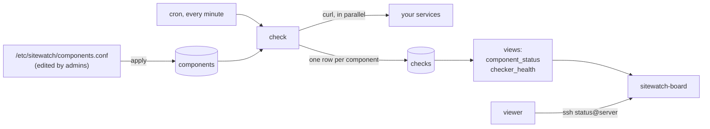

# Site Watch

**A status page with no web app. Your terminal is the browser.**

```
$ ssh status@status.example.com

SITE WATCH STATUS                              1 Nov 2026, 18:45

Overall: PARTIAL OUTAGE

  website      Operational
  api          Operational
  login        Partial Outage
  payments     Degraded Performance
  github       Operational

Last check: 18:45 (20 seconds ago)

Connection to status.example.com closed.
```

Site Watch checks your services every minute, works out whether each one is up, slow or down, and shows it to anyone holding a viewer key, through plain SSH. No web server, no frontend, no framework. It's built from Bash, PostgreSQL, cron, systemd and OpenSSH, and every part runs with only the permissions it needs.


---

## Why

When something breaks, every customer asks the same question at the same time: *is it down, or is it just me?* A status page answers it once, for everyone. Site Watch is that page, kept as small as possible:

- **Detects problems by itself:** every component is checked every minute.
- **Doesn't panic over a blip:** a status is judged on the last 5 checks, so one slow response doesn't flip the board.
- **Never shows green when blind:** if the checker itself stops, the board says the data is stale instead of showing an old "Operational".
- **Hard to misuse:** a viewer key gets the board and nothing else. No shell, no port forwarding, no database access beyond two read-only views.

## How it works



1. **Admins** list what to monitor in one plain-text file and run **`apply`**, which checks the file and makes the database match it.
2. **`check`** runs every minute from cron. It contacts every active component at the same time, each with a 10-second timeout, and records the status code, the response time, or the reason it failed.
3. **Two SQL views** turn those raw checks into a status. Nothing is stored by hand: status is always calculated from the data.
4. **Viewers** run `ssh status@<server>`. An SSH forced command runs the board, prints it, and closes the connection.

### Status rules

Each component is judged on its **last 5 checks from the last 15 minutes**. A check succeeds if it gets an HTTP status from 200 to 399.

| Status | Rule |
|---|---|
| **Operational** | All recent checks succeeded and were fast |
| **Degraded Performance** | All succeeded, but 3 or more took longer than 1000 ms |
| **Partial Outage** | Some checks failed |
| **Major Outage** | Every recent check failed |

The overall banner shows the worst component's status. If no check has run for 5 minutes, the banner says **UNKNOWN** and the board shows a stale-data warning instead of the statuses.

---

## Security model

Every actor gets its own identity, with exactly the access its job needs:

| Who | Is | Can | Cannot |
|---|---|---|---|
| **`sitewatch`** | System user (no login, no password) and the matching database role | Read the config, run the checker, write the database | Log in, use `sudo` |
| **`sitewatch-admins`** | Group of staff members | Edit `components.conf` with `sudoedit`, run `apply` (or `apply --dry-run`) as `sitewatch` | Anything else as root or as `sitewatch` |
| **`status`** | User for viewers, plus a read-only database role | See the board | Get a shell, forward ports, read any table, change anything |
| **Viewers** | One SSH key each, in `status`'s `authorized_keys` | `ssh status@server` | Anything except the board |

Other details:

- **SSH:** key-only login, no root login. Only port 22 is open to the internet.
- **PostgreSQL** listens on `127.0.0.1` only and uses **peer authentication**, so there is **no database password anywhere**: Postgres asks the kernel which Linux user is connecting.
- **The stand-in services** run under systemd with `NoNewPrivileges`, `ProtectSystem=strict` and `ProtectHome`.
- **Every admin action goes through `sudo`**, so it's logged under the real person's name.

---

## Repository layout

```
bin/
  apply        validate components.conf and sync it to the database
  check        check every active component once (run by cron)
  board        print the status board (installed as sitewatch-board)
  standin      tiny fake service for testing (answers "200 OK")
sql/
  schema.sql   tables, indexes, triggers, lookup data
  views.sql    component_status and checker_health
systemd/
  standin@.service   template unit: one copy per stand-in service
```

---

## Installation

Tested on **Ubuntu 24.04 LTS** with **PostgreSQL 16**. Every step runs on the server as an admin with `sudo`, unless it says otherwise.

### 1. Lock down SSH

Create `/etc/ssh/sshd_config.d/10-sitewatch.conf`:

```
PermitRootLogin no
PasswordAuthentication no
KbdInteractiveAuthentication no
```

Test the config, then reload. Keep your current session open, and test from a second terminal before closing it.

```bash
sudo sshd -t && sudo systemctl reload ssh
```

### 2. Install packages and create the service user

```bash
sudo apt update && sudo apt install -y postgresql curl git
sudo adduser --system --group sitewatch
```

### 3. Get the code

```bash
sudo mkdir /opt/sitewatch
sudo chown "$USER":sitewatch /opt/sitewatch
sudo chmod 750 /opt/sitewatch
git clone git@github.com:<you>/sitewatch.git /opt/sitewatch
```

`sitewatch` can enter and read the code through its group, but can't change it.

### 4. Create the database

```bash
sudo -u postgres createuser sitewatch
sudo -u postgres createdb -O sitewatch sitewatch_db

cd /opt/sitewatch
sudo -u sitewatch psql -d sitewatch_db -v ON_ERROR_STOP=1 -f sql/schema.sql
sudo -u sitewatch psql -d sitewatch_db -v ON_ERROR_STOP=1 -f sql/views.sql
```

Run the SQL files as `sitewatch`, so it owns the tables and views.

### 5. List your components

```bash
sudo mkdir /etc/sitewatch
sudo chown root:sitewatch /etc/sitewatch && sudo chmod 750 /etc/sitewatch
sudo touch /etc/sitewatch/components.conf
sudo chown root:sitewatch /etc/sitewatch/components.conf && sudo chmod 640 /etc/sitewatch/components.conf
sudoedit /etc/sitewatch/components.conf
```

One component per line: **name**, **URL**, **internal or external**. Blank lines and `#` comments are ignored.

```
# name      url                            type
website     http://127.0.0.1:8001/         internal
api         http://127.0.0.1:8002/         internal
login       http://127.0.0.1:8003/         internal
payments    http://127.0.0.1:8004/         internal
github      https://www.githubstatus.com   external
```

Then load it:

```bash
sudo -u sitewatch /opt/sitewatch/bin/apply --dry-run   # preview
sudo -u sitewatch /opt/sitewatch/bin/apply             # apply
```

### 6. Let staff manage components

```bash
sudo groupadd sitewatch-admins
sudo visudo -f /etc/sudoers.d/sitewatch
```

```
%sitewatch-admins ALL=(root) NOPASSWD: sudoedit /etc/sitewatch/components.conf
%sitewatch-admins ALL=(sitewatch) NOPASSWD: /opt/sitewatch/bin/apply "", /opt/sitewatch/bin/apply --dry-run
```

Add someone with `sudo usermod -aG sitewatch-admins <user>`, using **both** `-a` and `-G`. File names in `sudoers.d` must not contain a `.`, or sudo ignores the file.

### 7. Start the checker

```bash
sudo mkdir /var/log/sitewatch
sudo chown sitewatch:sitewatch /var/log/sitewatch && sudo chmod 750 /var/log/sitewatch
```

Create `/etc/cron.d/sitewatch` (owned by root, `644`, **ending with a newline**):

```
* * * * * sitewatch /opt/sitewatch/bin/check 2>> /var/log/sitewatch/check.log
```

Within a minute or two, results start arriving:

```bash
sudo -u sitewatch /opt/sitewatch/bin/check -v              # one run by hand, with a results table
sudo -u sitewatch psql -d sitewatch_db -c "select * from component_status"
```

### 8. Open the board to viewers

```bash
# the board itself: anyone can run it, only root can change it
sudo install -o root -g root -m 755 /opt/sitewatch/bin/board /usr/local/bin/sitewatch-board

# the viewer account: a real shell (needed for the forced command), no password
sudo adduser --disabled-password --gecos "" status

# a read-only database role that can see the two views and nothing else
sudo -u postgres createuser status
sudo -u sitewatch psql -d sitewatch_db -c "grant connect on database sitewatch_db to status"
sudo -u sitewatch psql -d sitewatch_db -c "grant select on component_status, checker_health to status"

sudo -u status sitewatch-board    # should print the board
```

Add each viewer's public key to `/home/status/.ssh/authorized_keys` (`.ssh` is `700`, the file is `600`, both owned by `status`), one line per viewer:

```
restrict,pty,command="/usr/local/bin/sitewatch-board" ssh-ed25519 AAAA... viewer-name
```

- `restrict` turns off everything extra, including port forwarding, which could otherwise reach the server's localhost-only services.
- `pty` turns the terminal back on, so the board prints in colour.
- `command=` is the forced command: the board runs, whatever the viewer asks for.

Viewers can now run:

```bash
ssh -i ~/.ssh/<viewer-key> status@<server>
```

---

## Testing with stand-in services

`bin/standin` is a tiny fake service, so you can test outages without breaking anything real. One template unit runs as many copies as you like.

```bash
sudo cp /opt/sitewatch/systemd/standin@.service /etc/systemd/system/
sudo mkdir /etc/sitewatch/standin
printf 'STANDIN_NAME=login\nSTANDIN_PORT=8003\n' | sudo tee /etc/sitewatch/standin/login.env
sudo systemctl daemon-reload
sudo systemctl enable --now standin@login        # and website, api, payments
```

| To see | Do |
|---|---|
| **Partial, then Major Outage** | `sudo systemctl stop standin@login`, then watch the board for about 5 minutes |
| **Recovery** | `sudo systemctl start standin@login` |
| **Degraded Performance** | Set `STANDIN_DELAY_MS=1500` in `payments.env`, then `sudo systemctl restart standin@payments` |
| **Stale-data warning** | Comment out the cron line and wait 5 minutes |

---

## Day-to-day use

| Task | Command |
|---|---|
| Add, change or retire a component | `sudoedit /etc/sitewatch/components.conf`, then `sudo -u sitewatch /opt/sitewatch/bin/apply` |
| Preview a change | `sudo -u sitewatch /opt/sitewatch/bin/apply --dry-run` |
| See the board as a viewer | `ssh status@<server>` |
| Check the checker's own errors | `tail /var/log/sitewatch/check.log` (empty means healthy) |
| Deploy new code | `git pull` in `/opt/sitewatch`, then re-run `sql/views.sql` and re-install the board if they changed |

Removing a line from the config **retires** the component (`is_active = false`). It's never deleted, because its history depends on it. `apply` refuses an empty file, since applying it would retire everything.

---

## Troubleshooting

Real problems hit while building this:

| Symptom | Cause |
|---|---|
| A service fails with **`status=203/EXEC`** | systemd couldn't start the program: the file is missing, has no execute bit, or has Windows line endings in the shebang. Check `journalctl -u <unit>` |
| **The cron job does nothing, and the log stays empty** | The log file was created by root, so `sitewatch` can't append and cron throws the error away. New files take the creator's owner, not the folder's |
| **`systemctl status postgresql` says `active (exited)`** | That unit is only a wrapper. The real database is `postgresql@16-main`. Use `pg_lsclusters` |
| **`role "…" is not permitted to log in`** | `CREATE ROLE` doesn't include login. Use `createuser`, or `ALTER ROLE … LOGIN` |
| **A sudoers or cron.d file is ignored** | File names containing a `.` are skipped in both folders |
| **`sudo -u someone sudoedit …` is denied** | sudo turns that into "edit as `someone`". Get a shell as the user first, then run `sudoedit` |

---

Built as a hands-on project consolidating Linux, SSH, Git and PostgreSQL.
